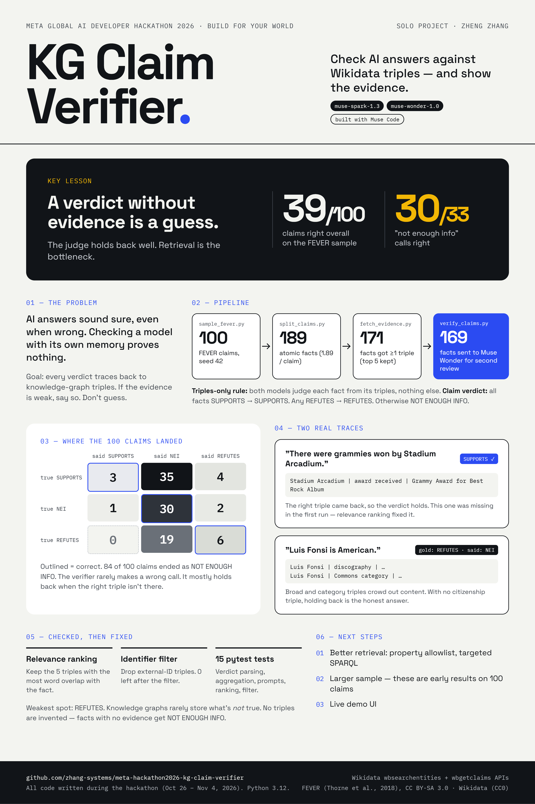

# Knowledge-Graph Claim Verifier

Verify AI answers against Wikidata triples. Built for the Meta Global AI Developer Hackathon (Build for Your World).

## Built with Meta models

- [Muse Spark 1.3](https://dev.meta.ai/models/muse-spark) (muse-spark-1.3) via the Meta Model API: claim splitting and first verification.
- [Muse Wonder 1.0](https://dev.meta.ai/models/muse-wonder) (muse-wonder-1.0) via the Meta Model API: second review of hard cases.
- [Muse Code](https://dev.meta.ai/lp/muse-code): coding agent used to build this repo.

## Situation

AI answers sound confident even when they are wrong. A claim like "Stadium Arcadium won Grammys" needs checking against evidence, not against the same model's memory. I wanted a checker that shows its evidence: every verdict must trace back to triples from a knowledge graph, and when the evidence is too weak, the checker must say so instead of guessing.

## Task

I set out to build a verifier that takes a claim, splits it into atomic facts, fetches evidence triples from Wikidata for each fact, and judges each fact only from those triples. I scoped it to a 100-claim sample from FEVER with honest scoring against the gold labels, using Meta models, during the hackathon building period.

## Action

I designed and built a four-step pipeline. First, I sampled 100 claims from FEVER (labelled_dev, deduped by id, seed 42). Second, I used Muse Spark to split each claim into atomic facts (189 total, 1.89 per claim). Third, I fetched evidence from Wikidata for each fact: search for the best-matching entity, then keep the 5 triples most relevant to the fact by word overlap, with identifier triples (external IDs) filtered out. Fourth, I verified each fact with Muse Spark under a triples-only rule, and sent every fact judged NOT ENOUGH INFO to Muse Wonder for a second review under the same rule. I aggregated claim verdicts from atomic verdicts (all SUPPORTS -> SUPPORTS; any REFUTES -> REFUTES; else NOT ENOUGH INFO). I built it with Muse Code, and I checked each step against its own output before moving on. Two fixes came out of those checks: relevance ranking (the award triple for Stadium Arcadium was missing in the first run) and the identifier filter.

## Result

On the 100-claim sample, the verifier scored 39/100 (0.390): SUPPORTS 3/42, NOT ENOUGH INFO 30/33, REFUTES 6/25. 171 of 189 facts retrieved at least one triple, and 169 of 189 facts went to second review. The result is honest about the bottleneck: the verifier is conservative by design and answers NOT ENOUGH INFO when the evidence is weak, and retrieval noise (broad and category triples crowding out content triples) limits recall on SUPPORTS and REFUTES. When the right triple is retrieved, the mechanism works: "There were grammies won by Stadium Arcadium" verifies via `award received | Grammy Award for Best Rock Album`. Refutation is the weakest part, because knowledge-graph triples rarely carry negative evidence. These are preliminary results on a 100-claim sample.

## Run it

Python 3.12. Install dependencies:

pip install datasets==2.21.0 python-dotenv openai pytest

Set up the key (never commit it):

cp .env.example .env

Fill in MODEL_API_KEY (Meta API key), MODEL_API_BASE_URL, and MODEL_API_MODEL in .env.

Run the pipeline in order:

python scripts/sample_fever.py
python scripts/split_claims.py
python scripts/fetch_evidence.py
python scripts/verify_claims.py

Run the tests:

python -m pytest tests/

## Repo layout

scripts/: sample_fever.py, split_claims.py, fetch_evidence.py, verify_claims.py. data/: sample.jsonl, split_claims.jsonl, evidence.jsonl, verdicts.jsonl (evidence_v1_noisy.jsonl and evidence_v2_ranked.jsonl are earlier runs, kept for comparison). tests/: pytest suite covering verdict parsing, aggregation, prompt contents, relevance ranking, and the identifier filter.

## Data and models

Claims: FEVER (Thorne et al., 2018), CC BY-SA 3.0. Labels: SUPPORTS 42 / NOT ENOUGH INFO 33 / REFUTES 25. Evidence: Wikidata (CC0), via the public wbsearchentities and wbgetclaims APIs. No triples are invented; facts with no evidence get NOT ENOUGH INFO. Models (Meta): Muse Spark 1.3 (muse-spark-1.3) for splitting and first verification; Muse Wonder 1.0 (muse-wonder-1.0) for second review of hard cases. All code in this repo was written during the hackathon building period (Oct 26 - Nov 4, 2026).

## Poster

